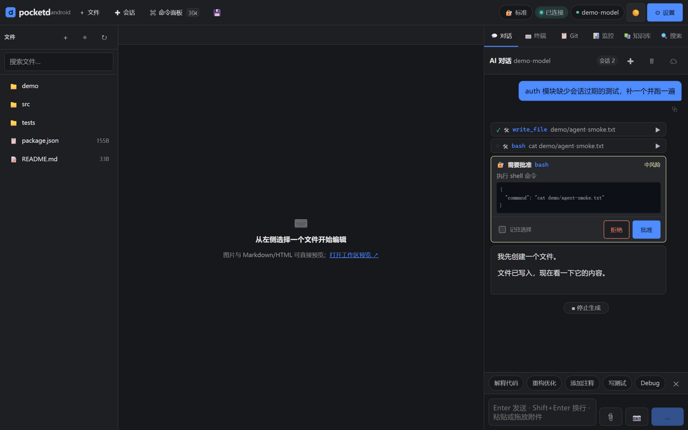
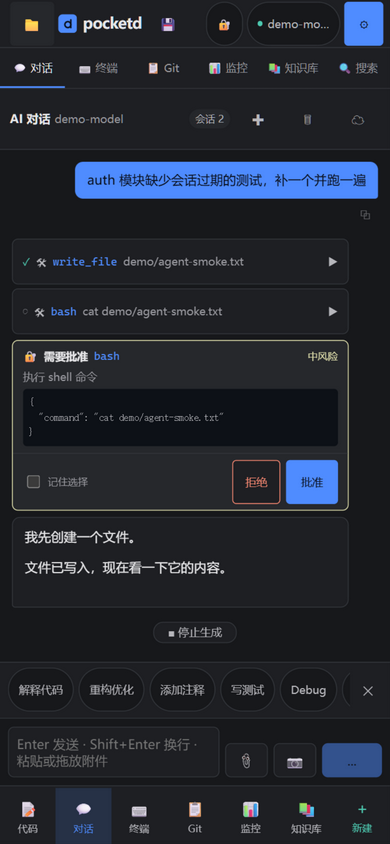
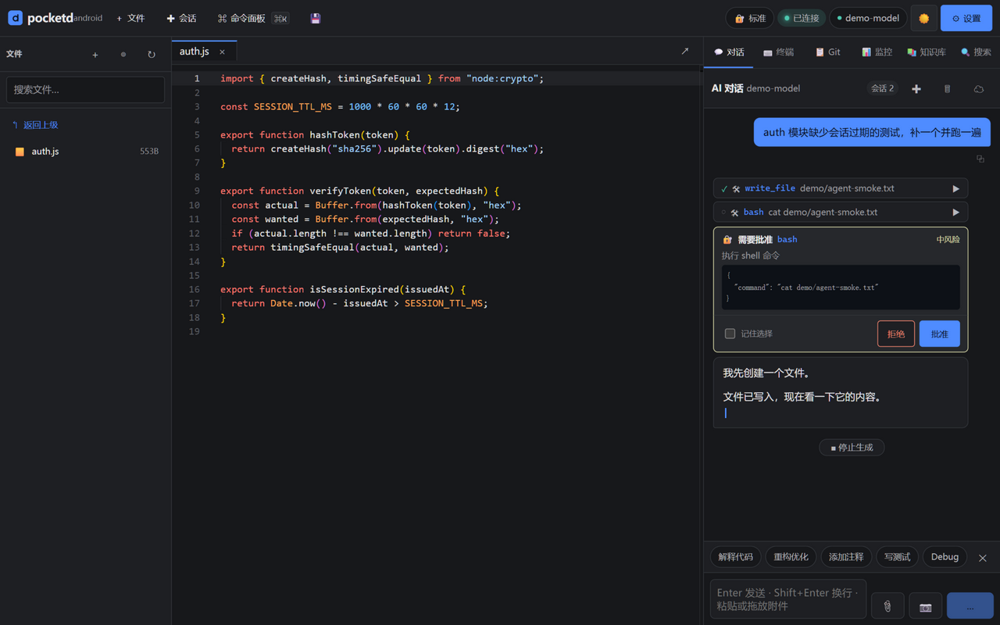
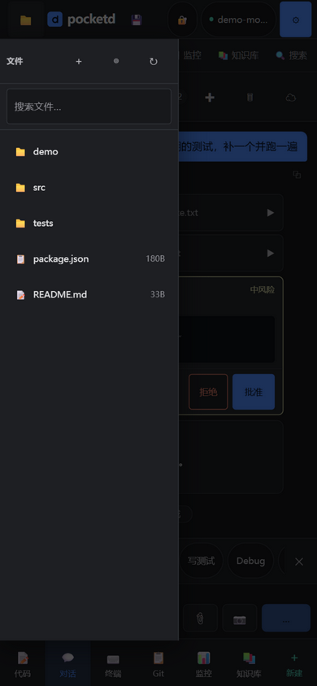
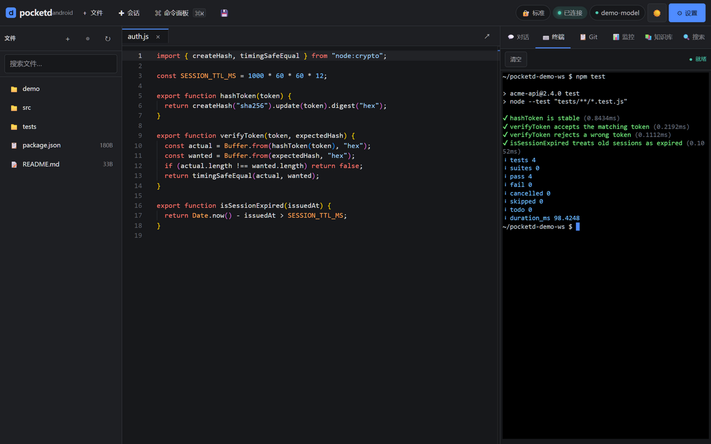

# pocketd — 把手机变成一个真正会干活的编码 agent

<div align="center">

**[English](README.md) | 中文 | [日本語](README.ja.md)**

[](LICENSE)
[](https://nodejs.org)
[](https://www.typescriptlang.org)
[](https://react.dev)
[](#开发与构建)

*在手机本地运行的编码 agent：直接读写你的工作区、执行命令、调 MCP，危险操作由你批准*

[快速开始](#快速开始) · [功能一览](#功能一览) · [API 端点](#http-api) · [技术架构](docs/ARCHITECTURE.md) · [设计决策](docs/adr/) · [移动适配](docs/MOBILE.md) · [贡献指南](CONTRIBUTING.md)

</div>

---

## 简介

pocketd 是一个独立的、本地优先的**编码 agent**，通过 [**Termux**](https://termux.dev) 在安卓手机上运行，用浏览器即可访问。

它不是套壳聊天：模型拿到的是一组**真实工具**——读写文件、精确编辑、搜索替换、执行 shell、查看 Git 状态、连接 MCP 服务器——每一步都在你设定的**审批策略**下操作工作区。**无需云账号、零 OAuth、零遥测**，所有数据留在你的设备。AI 能力由你自己的 API Key 驱动，兼容任何 OpenAI 协议提供商（DeepSeek、Moonshot、Groq、Ollama、OpenAI 等）。

### 手机上到底用它做什么

先说清楚它**不是**什么：不是让你在 6 寸屏上从零写功能的地方——没有键盘、没有多窗口，那件事笔记本做得比它好一个数量级。它真正成立的场景是：

| 场景 | 为什么手机更合适 |
|---|---|
| **指挥 agent 干活，然后揣兜里** | 说一句「修一下 auth 那个失败的测试」，锁屏走人，回来看 diff 或结果。**这是主要场景**，也是为什么运行不随连接结束 |
| **路上的外科手术式小改** | 改版本号、修错别字、调配置、revert 一个坏 commit——小、可界定、可验证 |
| **阅读** | 通勤时读一个 diff，或快速熟悉陌生代码 |
| **把手机当进服务器的终端** | Termux + 跳板机，终端标签页覆盖这块 |

由此有两条硬约束，都体现在实现里：

1. **对话是首页，不是六个标签之一。** 窄屏下应用直接落在对话面板，编辑器是「点一下过去」，而不是反过来。
2. **任何东西都不能依赖标签页一直开着。** 锁屏、切应用、Android 回收后台标签在手机上是**常态而非边界情况**——所以有了服务端持有的运行、15 分钟的审批窗口、以及重开页面自动接回。

### 说句不客气的话：运行时上限

没有 APK 就是没有前台服务，也就没有可靠的通知；`node-pty` 需要在设备上编译（clang/make，部分 ABI 会失败）；Android 的电池优化会杀 Termux。**"一个不会通知你的手机 agent，等于一个你必须盯着看的网页"**——这个限制在现有形态下无法根治，只能减轻。所以我们把能在这些限制内做到的可靠性都做了：运行脱离客户端、审批窗口够长、重开自动接回、历史存服务端。

---

## 界面截图

| 桌面 | 手机 |
|---|---|
|  |  |
|  |  |
|  | *终端与 Git 面板在底部导航一键可达* |

---

## 功能一览

| Module | Features |
|--------|----------|
| **Agent** | 11 个内置工具 · 多步工具循环（最多 40 步）· 工具调用可视化 · 三档审批策略 · 硬拒绝清单 · "记住选择"免审批 |
| **断连可恢复** (Resilience) | **关页/锁屏不中断任务**（运行由服务端持有）· 重开页面自动接回并回放历史 · 审批窗口 15 分钟 · 连接中断时有明确提示与「重新接回」入口 |
| **审批** (Approval) | `bash`/删除/MCP 默认需批准 · 危险分级 · 参数预览 · 超时按拒绝（fail closed）· 失效卡片显式标记 |
| **MCP** (Tools) | 官方 SDK · **HTTP 与 stdio 双 transport** · 自动发现注册 · 工具名合规化 · 设置界面增删启停 |
| **编辑器** (Editor) | Monaco Editor · 多标签 · 语法高亮 · `Ctrl+S` 保存 · 触屏调优 |
| **文件树** (Files) | 目录导航 · 模糊搜索 · 新建 · 删除进回收站（**可恢复到原路径**）· 拖拽上传 · 被忽略项灰显标记 · 隐藏文件开关 |
| **忽略规则** (Ignore) | `.gitignore` **实时读取**（不维护副本，永不「同步过期」）· `.pocketdignore` 叠加规则 · 旧 `.zcodeignore` 沿用 · `node_modules` 之类不再被递归扫描 · `include_ignored` 可显式绕过 |
| **终端** (Terminal) | xterm.js · node-pty · 完整 bash/zsh · WebSocket streaming |
| **对话** (Chat) | 流式 SSE · 工具调用卡片 · 审批卡片 · 多会话（**服务端同步 + 一键恢复**）· slash 命令 · 附件（粘贴/拖拽/拍照）· 多模态视觉 · 思考过程显示 |
| **上下文** (Context) | 自动限幅：最近 12 轮原文保留，更早的工具流量降级；裁剪时明确告知，且不会产生非法的工具消息序列 |
| **预览与浏览器** (Preview) | **图片直接看**（不再报"二进制文件"）· Markdown 渲染预览 · HTML 在沙箱 iframe 里预览 · **工作区当静态站点浏览**（`/preview/`，目录索引 + 相对资源可解析）· 单文件"新标签页打开" |
| **流式体验** (Streaming) | 光标跟随输出 · **不抢用户的滚动位置**（往上翻时给"回到底部"提示）· 工具调用进行中有呼吸态 · 代码块一键复制 · 消息一键复制 |
| **Git** | 分支图（ahead/behind）· diff/log/add/commit · merge · push/pull/fetch · checkout/branch/remote |
| **搜索** (Search) | 结构化 `路径:行:列` 结果 · 跨平台（不依赖 grep 二进制）· 跳转行号 |
| **替换** (Replace) | 先预览后提交 · 改动文件与匹配数列表 · 正则/字面量语义一致 |
| **知识库** (Knowledge) | 自动扫描项目结构 → 富 Markdown 文档，与对话共用同一渲染器 |
| **监控** (Stats) | 真实 token 用量 · 7 天趋势图 · 调用历史 |
| **安全** (Security) | 默认只监听本机 · 非回环强制访问令牌 · 路径沙箱（含符号链接防护） |
| **设置** (Settings) | 5 个 provider 预设 · 审批策略切换 · 工具清单 · 访问令牌 · MCP 管理 |
| **设计系统** (Design) | 8 级字号阶梯 · 对比度全部达 WCAG AA（实测值记在 token 旁）· 双主题完整（含 Monaco / xterm / 代码高亮）· 44px 触控目标 |
| **品牌** (Brand) | 几何 d 标记（组件与 favicon 同几何，有测试守护）· PNG 图标含 maskable 安全区 · apple-touch-icon · OG/Twitter 元信息 · 动态 theme-color |
| **主题 / 移动** | dark/light CSS vars · bottom 5-tab nav · safe-area · ARIA · 触屏不显示 ⌘/Ctrl 提示 |
| **引导** (Onboarding) | 3-step first-run wizard |

---

## 快速开始

### 安卓手机 (Termux)

```bash
# 1. 安装 Termux 系统依赖
pkg update -y
pkg install -y nodejs git python make clang pkg-config

# 2. 克隆并进入项目
git clone https://github.com/badhope/pocketd.git
cd pocketd

# 3. 一键安装 + 构建 + 启动
chmod +x termux-setup.sh && ./termux-setup.sh
```

脚本会装依赖、构建前端、写好 `~/.pocketd/env`，然后**在前台启动服务**（Ctrl+C 停止）。

在 Chrome for Android 打开 `http://localhost:3030`，菜单里选 **添加到主屏幕**，即得到一个独立窗口的 PWA（无地址栏、含图标与深色主题）。pocketd 不含 APK：Node 运行时无法进入 Capacitor 之类的 WebView 壳，编辑器、终端、Git 都由 Termux 里的这个进程提供。

想让它常驻后台：

```bash
termux-wake-lock           # 防止系统休眠回收
nohup npm start > ~/.pocketd/server.log 2>&1 &
```

### macOS / Linux / Windows

需要 **Node ≥ 24.15**（`node -v` 检查）。前端测试用的 jsdom 30 要求 24.15 以上；
更低版本的 24.x 能跑服务本身，但 `npm run test:ui` 会因引擎不满足而受限。

```bash
git clone https://github.com/badhope/pocketd.git
cd pocketd
npm install
cd ui && npm install && npm run build && cd ..
npm start
```

打开浏览器访问 `http://localhost:3030`。

> 默认配置通过 `~/.pocketd/env` 加载，也可以在浏览器 Settings 界面直接填写。[详见配置说明](#配置)。

---

## 配置

AI 能力需要填写 API Key（兼容 OpenAI / DeepSeek / Moonshot / Groq / Ollama 等任意提供商）。

### 环境变量（`~/.pocketd/env`）

```bash
export POCKETD_API_KEY="sk-xxx"
export POCKETD_API_BASE="https://api.deepseek.com/v1"
export POCKETD_API_MODEL="deepseek-chat"
export POCKETD_WORKSPACE="$HOME/.pocketd/workspace"
export POCKETD_PORT="3030"
export POCKETD_HOST="127.0.0.1"        # 设为 0.0.0.0 时强制访问令牌鉴权
export POCKETD_APPROVAL_MODE="edits"   # auto | edits | strict
export POCKETD_SHELL=""                # 可选，覆盖 agent 执行命令所用的 shell
```

旧前缀 `ZCODE_*` 仍会被读取，已有配置无需改动。

### 审批策略

| 模式 | 行为 |
|------|------|
| `auto` | 不询问。硬拒绝清单仍然生效（`rm -rf /`、`mkfs`、`dd of=/dev/sd*`、fork 炸弹等永远拦截且不可批准） |
| `edits`（默认） | 改文件放行；执行命令、删除文件、MCP 工具需批准 |
| `strict` | 除只读工具（读文件/列表/搜索/Git 查看）外全部需批准 |

在 Settings 里切换，或在对话中发 `/approve auto|edits|strict`。批准时勾选"记住选择"会把该
命令首词或该目录加入免审批列表，可在 Settings 一键撤销。

### 浏览器 Settings

启动后点右上角 ⚙️ **Settings**：填 API Key → **测试连接**；往下可以切换审批策略、查看已加载的工具清单、复制访问令牌、增删 MCP 服务器（**HTTP 远程**或 **stdio 本地**）。

| Provider | Base URL | Suggested Model |
|----------|----------|-----------------|
| DeepSeek | `https://api.deepseek.com/v1` | `deepseek-chat` |
| Moonshot | `https://api.moonshot.cn/v1` | `moonshot-v1-8k` |
| Groq (free) | `https://api.groq.com/openai/v1` | `llama-3.3-70b-versatile` |
| Ollama (local) | `http://localhost:11434/v1` | `qwen2.5-coder` |
| OpenAI | `https://api.openai.com/v1` | `gpt-4o` |

### MCP 服务器

```jsonc
// HTTP 远程
{ "name": "github", "type": "http", "url": "https://example.com/mcp" }

// stdio 本地（cwd 为工作区）
{ "name": "my-tool", "type": "stdio", "command": "node", "args": ["/path/to/server.js"] }
```

配置存于 `~/.pocketd/state/mcp.json`，启动时自动重连。模型看到的工具名是
`mcp__<服务器名>__<工具名>`（已按 OpenAI 函数名规范转换）。

---

## HTTP API

完整 HTTP + WebSocket 接口一览：

| Endpoint | Method | Description |
|----------|--------|-------------|
| `/` | GET | SPA 入口 |
| `/assets/*` | GET | 静态 JS/CSS |
| `/api/status` | GET | 服务状态：工作区、模型、已加载工具、MCP 连接情况 |
| `/api/auth/token` | GET | 读取访问令牌（**仅回环地址**） |
| `/api/config` | GET / POST | 查看 / 保存 API 配置 |
| `/api/config/test` | POST | 由服务器直连上游做连通性测试（避开浏览器 CORS） |
| `/api/files` | GET | `?path=.` 列出目录 |
| `/api/file` | GET / POST / PUT / DELETE | 读 / 写 / 新建 / 删除文件 |
| `/api/trash` | GET | 列出回收站条目（含原始路径与删除时间） |
| `/api/file/raw` | GET | 原始字节（图片/二进制预览、下载） |
| `/preview/*` | GET | **把工作区当静态站点访问**：文件直出、目录给索引页；同一条路径沙箱，越界拒绝 |
| `/api/trash/restore` | POST | 按原始路径恢复文件 |
| `/api/search` | GET | 结构化搜索（`?q=`, `?regex=1`, `?case=1`, `?ext=`） |
| `/api/replace` | POST | 跨文件替换（`dryRun` 默认建议 true，先预览后落盘） |
| `/api/agent/sessions` | GET | 会话列表 |
| `/api/agent/sessions/:id` | GET / PUT / DELETE | 读取 / 覆写 / 删除会话 |
| `/api/agent/tools` | GET | 当前可用工具清单（内置 + MCP） |
| `/api/agent/policy` | GET / POST | 读取 / 切换审批策略 |
| `/api/agent/policy/always-allow` | DELETE | 撤销免审批项 |
| `/api/agent/approval` | POST | 回应一次待批准的工具调用 |
| `/api/git/*` | — | init / status / add / commit / log / diff / branches / checkout / branch / merge / push / pull / fetch / remotes |
| `/api/mcp/servers` | GET / POST / DELETE | MCP 服务器管理（POST 支持 http 与 stdio） |
| `/api/mcp/servers/:name/toggle` | POST | 启用/停用 MCP 服务器 |
| `/api/mcp/reload` | POST | 重新初始化 MCP 连接 |
| `/api/knowledge/generate` | GET | 生成项目知识文档 |
| `/api/chat/stream` | POST | 启动一次 agent 运行（响应头带 `x-pocketd-run-id`），SSE 事件见下 |
| `/api/agent/runs` | GET | 最近的运行列表（用于发现仍在进行中的任务） |
| `/api/agent/runs/:id` | GET | 运行状态 + 事件回放（`?from=N`） |
| `/api/agent/runs/:id/stream` | GET | **重连**：先回放 `?from=N` 之后的事件，再转直播 |
| `/api/agent/runs/:id/cancel` | POST | 取消运行（取消的是**运行**，不是连接） |

### SSE 事件契约

| 事件 | 说明 |
|---|---|
| `run-start` | 运行开始，带可用工具清单 |
| `step` | 上游往返一次 |
| `message` / `thinking` | 文本增量 / 推理增量 |
| `tool-call` / `tool-result` | 工具调用与其结果（含 `isError`） |
| `approval-request` | 需要批准，客户端 POST `/api/agent/approval` 回应 |
| `run-status` | 运行快照（含待批项）；每次回放的末尾一定会收到一条 |
| `truncated` | 请求的起点已被环形缓冲丢弃，客户端需重建消息 |
| `usage` | 真实 token 用量 |
| `run-finish` | 运行收尾 |
| `error` / `warning` / `aborted` | 错误 / 警告（含「已省略 N 条历史」）/ 被取消 |
| `data: [DONE]` | 流终止 |
| `: ping` | 等审批时每 20 秒一次的心跳注释 |
| `/ws/terminal` | WebSocket | PTY 终端（需 node-pty；非回环需令牌） |

---

## 目录结构

```
pocketd/
├── server.ts                 # 接入层：Hono 路由、令牌门禁、终端 WS、SPA
├── src/agent/                # Agent 核心
│   ├── runtime.ts            #   工作区沙箱、路径解析、回收站、密钥、目录遍历
│   ├── tools.ts              #   内置工具集 + shell 执行
│   ├── permissions.ts        #   审批策略、硬拒绝规则、审批往返 broker
│   ├── loop.ts               #   多步 agent 循环（Vercel AI SDK）
│   ├── mcp.ts                #   MCP 客户端管理（官方 SDK，HTTP + stdio）
│   ├── sessions.ts           #   会话持久化（node:sqlite）
│   ├── search.ts             #   搜索替换（Node 标准库）
│   ├── ignore.ts             #   gitignore 语义的忽略规则
│   ├── shell.ts              #   POSIX shell 优先的解析（ADR-003）
│   └── git.ts                #   Git 调用
├── tests/
│   ├── agent.test.ts         # 工具层 / 权限 / 循环 回归测试
│   ├── brand-assets.test.ts  # 图标与 manifest 像素级校验
│   ├── e2e-server.mts        # 真实服务 + stdio MCP 端到端
│   └── fixtures/             # 假 LLM 上游、MCP 测试服务器
├── tools/
│   ├── make-icons.mjs        # 生成 PNG 品牌图标（零依赖）
│   └── png-read.mjs          # 读回像素做断言的解码器
├── ui/                       # 前端 (Vite + React + TS)
│   ├── src/
│   │   ├── App.tsx / main.tsx / store.ts
│   │   ├── monaco-themes.ts  # Monaco 双主题定义（与 CSS token 对齐）
│   │   ├── lib/              # API 客户端、对话框 API、品牌、视口 hook
│   │   └── components/       # 对话 / 编辑器 / 文件树 / 终端 / Git / 搜索 / 统计
│   ├── public/               # 图标（SVG + 生成的 PNG）与 manifest
│   └── dist/                 # 构建产物（已 gitignore）
├── docs/
│   ├── ARCHITECTURE.md       # 技术深潜（含设计系统）
│   ├── adr/                  # 架构决策记录
│   └── MOBILE.md             # 移动端与无障碍说明
├── termux-setup.sh           # Termux 一键安装 / 启动
├── TERMUX-QUICKSTART.md
├── CONTRIBUTING.md
└── LICENSE
```

---

## 整体架构

```
┌────────────────────────────────────────────────────────────────┐
│                    Android Device / macOS / Linux              │
│                                                                │
│  ┌──────────────┐        ┌──────────────────────────────────┐  │
│  │ Browser (PWA)│        │ Termux / Localhost               │  │
│  │  Monaco      │        │  ┌────────────────────────────┐  │  │
│  │  xterm       │◀──────▶│  │ server.ts  接入层          │  │  │
│  │  工具/审批 UI│  SSE   │  │  Hono · 令牌门禁 · ws      │  │  │
│  └──────────────┘   +WS  │  └────────────┬───────────────┘  │  │
│                          │               │                  │  │
│                          │  ┌────────────▼───────────────┐  │  │
│                          │  │ Agent 核心 (src/agent)     │  │  │
│                          │  │  loop ─ tools ─ permissions│  │  │
│                          │  │  mcp · sessions · search   │  │  │
│                          │  └────────────┬───────────────┘  │  │
│                          │               │                  │  │
│                          │    文件系统 / shell / git / MCP   │  │
│                          │              + node-pty          │  │
│                          └──────────────────────────────────┘  │
└────────────────────────────────────────────────────────────────┘
```

前端 SPA 由 `ui/dist/` 提供。对话走 SSE（文本增量、工具调用、审批请求、用量），终端走 WebSocket。Agent 循环在服务端跑，工具直接作用于工作区。所有数据留在本地 `~/.pocketd/`。

> 技术详情见 [docs/ARCHITECTURE.md](docs/ARCHITECTURE.md)，关键取舍见 [docs/adr/](docs/adr/)

---

## 开发与构建

```bash
# 服务端 — 启动 (需要 ui/dist 已存在)
npm install
cd ui && npm install && npm run build && cd ..
npm start

# 前端 — 独立开发 (HMR)
cd ui && npm install && npm run dev

# 类型检查（服务端 + 前端）
npm run typecheck

# 测试：服务端工具层与 agent 循环
npm test

# 测试：前端组件（Vitest + Testing Library）
npm run test:ui

# 测试：端到端（真实服务 + 真实 stdio MCP + 审批往返）
npm run test:e2e

# 生产打包
npm run build

# 重新生成品牌图标（改了 Brand.tsx 的标记几何后需要）
npm run icons
```

服务会根据 `ui/dist/index.html` 是否存在来决定：有 → 提供 SPA；无 → 返回 503 并提示先构建前端。

没有真实 API Key 也能跑起来：`npm run test:e2e` 内置一个假的 OpenAI 兼容上游；
手动冒烟可以起 `node tests/fixtures/fake-upstream.mjs 3198`，再把
`POCKETD_API_BASE=http://127.0.0.1:3198/v1` 指过去。

### 设计系统

配色、字号、圆角、层级全部集中在 `ui/src/index.css` 的 token 里，组件不写死色值与尺寸。
前景/背景的对比度按 WCAG 2.1 实算并记录在 token 旁；深色与浅色主题（含 Monaco、xterm、
代码高亮、原生控件色彩方案）都已完整，切换时浏览器 UI 的 `theme-color` 也会同步。

改视觉前请先看 [docs/ARCHITECTURE.md 的设计系统章节](docs/ARCHITECTURE.md#design-system)；
改品牌标记需同时更新 `ui/src/components/Brand.tsx` 与 `ui/public/pocketd-icon.svg`
（`npm test` 会校验两者几何一致），然后 `npm run icons` 重新生成 PNG。

---

## 安全

| 项 | 状态 |
|----|------|
| **监听与鉴权** | 默认只监听 `127.0.0.1`；设 `POCKETD_HOST=0.0.0.0` 后非回环请求强制访问令牌（256 位随机，存 `0600` 文件）。终端 WebSocket 同样校验 |
| **Agent 执行命令** | 统一走 `bash` 工具，受审批策略约束；硬拒绝清单（`rm -rf /`、`mkfs`、块设备写入、fork 炸弹等）不可批准 |
| **文件删除** | 移到 `回收站/` 并写 sidecar 元数据，可**恢复到原路径**；拒绝以工作区根为目标 |
| **路径沙箱** | 解析越界拒绝 + 对最深层已存在祖先做 `realpath`，符号链接无法把读写引出工作区 |
| **Markdown XSS** | `react-markdown` + `rehype-sanitize`（自定义 schema），聊天与知识库共用同一渲染器 |
| **请求体限制** | `/api/chat/stream` 10MB、`/api/file` 5MB |
| **工具输出** | 统一截断（30k 字符），避免单条命令灌爆上下文 |

以下为**已知未覆盖**项，公网暴露（不建议）前需要补：

- 无速率限制、无登录失败锁定（令牌本身无法暴力枚举，但缺少纵深防御）
- `bash` 工具不是沙箱——它是 shell。审批策略是唯一的闸门；`auto` 模式下等于放开
- MCP stdio 服务器以当前用户身份启动，其自身安全性不在 pocketd 控制范围内

---

## 故障排查

| Symptom | Fix |
|---------|-----|
| White screen | 未构建前端：`cd ui && npm run build` |
| Terminal not working | 未安装 `node-pty`：`pkg install clang make` (Termux) |
| Chat 502 / error | 检查 API Base / Key / Model 设置 |
| 503 status | `ui/dist/` 缺失，先构建前端 |
| 401 未授权 | 从其他设备访问时需带令牌：`?token=<令牌>`，令牌见手机上的 Settings |
| Port conflict | `POCKETD_PORT=4000 npx tsx server.ts` |
| 工具一直被拒绝 | 当前是 `strict` 模式；到 Settings 切到 `edits`，或批准时勾选"记住选择" |

---

## 依赖

**服务端** `package.json`:
- `hono` / `@hono/node-server` — HTTP 框架与 Node 适配器
- `ws` — WebSocket 服务端
- `ai` / `@ai-sdk/openai-compatible` — LLM 编排与 provider 适配
- `@modelcontextprotocol/sdk` — MCP 客户端（HTTP + stdio）
- `zod` — 工具参数 schema
- `simple-git` — Git 调用
- `ignore` — `.gitignore` 语义的忽略规则（搜索与 @ 候选用）
- `node-pty` *(可选)* — 终端 PTY 仿真，需 `clang + make`
- 会话存储用 Node 24 内置的 `node:sqlite`，搜索用 Node 标准库，均无额外依赖

**前端** `ui/package.json`:
- `react` / `react-dom` 19 — UI 框架
- `zustand` 5 — 状态管理
- `@monaco-editor/react` + `monaco-editor` — 代码编辑器
- `@xterm/xterm` 6 + `@xterm/addon-fit` + `@xterm/addon-web-links` — 终端
- `react-markdown` + `remark-gfm` + `rehype-sanitize` + `rehype-highlight` — Markdown 与代码高亮
- `vite` 8 + `@vitejs/plugin-react` — 构建工具
- `vitest` 5 + `@testing-library/*` + `jsdom` 30 — 测试

构建与类型检查用 **TypeScript 7**（原生实现，`tsc` 与 5.x 兼容）。

`ui/package.json` 里有一条 `overrides`：`dompurify: ^3.4.17`。`monaco-editor` 把 dompurify
锁在 3.4.15，而该版本有已披露的 XSS 问题；等 monaco 自己升级后可以删掉这条。

无任何 z.ai / BigModel / OAuth / 遥测依赖。

### 前端包体代价

highlight.js 的语言包被拆成 87 个**按需加载**的独立 chunk（合计约 468 KB 未压缩），只有代码块
出现该语言时才会下载。主 chunk 约 5.06 MB（gzip 1.33 MB），其中大头是 Monaco 编辑器与它的
worker（`ts.worker` 单独 6.9 MB）。构建产物总计约 15 MB，作为 PWA 安装一次后由 Service Worker 缓存。

---

## 相关项目

- [Termux](https://termux.dev) — Android terminal emulator
- [Hono](https://hono.dev) — Web framework
- [Vercel AI SDK](https://ai-sdk.dev) — LLM 编排与工具循环

---

## License

[MIT](LICENSE) © pocketd Contributors

本项目是独立开源实现，不包含任何第三方桌面 agent 的闭源代码。所有依赖均为 MIT / Apache-2.0 等开源组件。

### 关于改名的说明

这个项目最初叫 ZCode，是照着同名桌面 agent 的思路做的安卓版。那个名字与官方产品重合，
因此在首次公开发布前改名为 **pocketd**。

改名是**无损**的：旧的环境变量前缀 `ZCODE_*`、旧数据目录 `~/.zcode/`、旧的 localStorage
键、旧的令牌 cookie、旧的回收站目录、以及旧的 `.zcodeignore` 都会被读取，已有用户不会丢任何
东西。唯一无法做到无缝的是 PWA 的 `manifest.id` —— 它必须保持为 `/`，否则已安装的 PWA 会被
当成另一个应用而需要重装。这是唯一的真实代价，而且只发生一次。
